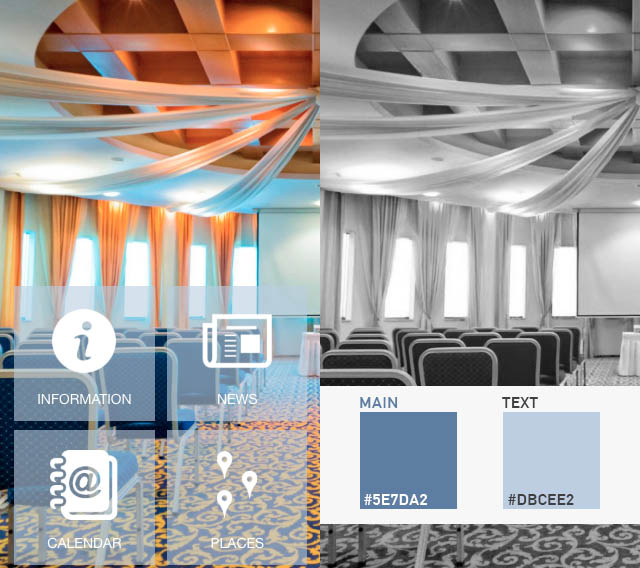

# Template

** *Note: Template packages require Siberian 5.1.0 and above, otherwise they will not work* **

Demo template can be found [here](../img/template/template-corporate.zip)! 

### What you need

* A nice template idea !

**And to define its name:**

* Your template name, like `TemplateAwesome`. note: always prefix it with `Template` this will avoid collision with modules!

## Structure of a template package

Templates are installed in the `app/local/modules` folder

&nbsp;

Below is the complete and minimal required structure for a template pack

```raw
TemplateAwesome.zip
├─ resources
│  ├─ db
│  │  └─ data
│  │     └─ template-awesome.php
│  └─ images
│     └─ templates
│        └─ awesome
│           └─ unified
│              ├─ background.jpg // Must be square and 2732x2732px
│              ├─ icon.jpg // Must be square and 512x512px
│              └─ overview_new.jpg // Must be 640x568px
└─ package.json
```

#### overview_new.jpg

Example



### package.json

The `package.json` is used by the Installer to know the requirements, and routines to run during the installation/update process of your Template pack

```json
{
    "name": "TemplateAwesome",
    "version": "2.0.0",
    "description": "Awesome template installer.",
    "dependencies": {
        "system": {
            "type": "SAE",
            "version": "5.1.0" /** 5.1.0 is required for the Template to work! */
        }
    },
    "type": "template" /** The type is important for Siberian to identify it as a template! */
}
```

|Field|Required&nbsp;?|Description|
|-----|---------------|-----------|
|name|yes|Package name, avoid spaces and numbers|
|description|yes|Package description|
|type|yes|must be `template`|
|version|yes|Your template pack version, for updates|
|dependencies|yes|**version*:** 5.1.0 minimum, **type:** SAE/MAE/PE minimum installation type required|

** * version must be at least 5.1.0**

### Data

`template-awesome.php`

This file creates & updates the entry in database and copy assets at installation time

If you need to change options in your module while providing an update you must change the values here

```php
<?php

// Icons
use Siberian\Feature;
use Siberian\Template;

// Custom icons
$icons = [
    'awesome1' => 'app/local/modules/TemplateAwesome/resources/media/library/awesome1.png',
    'awesome2' => 'app/local/modules/TemplateAwesome/resources/media/library/awesome2.png',
    'awesome3' => 'app/local/modules/TemplateAwesome/resources/media/library/awesome3.png',
    'awesome4' => 'app/local/modules/TemplateAwesome/resources/media/library/awesome4.png',
    'awesome5' => 'app/local/modules/TemplateAwesome/resources/media/library/awesome5.png',
    'awesome6' => 'app/local/modules/TemplateAwesome/resources/media/library/awesome6.png',
    'awesome7' => 'app/local/modules/TemplateAwesome/resources/media/library/awesome7.png',
    'awesome8' => 'app/local/modules/TemplateAwesome/resources/media/library/awesome8.png',
];

// We insert icons one by one, so we can get the icon_id for each, and use it in our features!
// We fill the array $libraryKeys with our "keys" so we can identify our icons later, to assign them to our features!
$libraryKeys = [];
foreach ($icons as $key => $icon) {
    $result = Feature::installIcons('TemplateAwesome', [$icon], false);
    $libraryKeys[$key] = $result;
}

// No changes here
$ionicColors = [
    'header' => [
        'color' => '#ffffff',
        'background_color' => '#5b5b5b'
    ],
    'background' => [
        'background_color' => '#e2e2e2'
    ],
    'homepage' => [
        'color' => '#5b5b5b',
        'background_color' => '#ffffff',
        'background_opacity' => '0',
        'border_color' => '#ffffff',
        'border_opacity' => '0',
        'image_color' => '#5b5b5b'
    ],
    'list_item_divider' => [
        'color' => '#ffffff',
        'background_color' => '#5b5b5b'
    ],
    'list_item' => [
        'color' => '#5b5b5b',
        'background_color' => '#ffffff',
        'border_color' => '#5b5b5b'
    ],
    'card_item_divider' => [
        'color' => '#ffffff',
        'background_color' => '#5b5b5b'
    ],
    'card_item' => [
        'color' => '#5b5b5b',
        'background_color' => '#ffffff'
    ],
    'buttons' => [
        'color' => '#ffffff',
        'background_color' => '#5b5b5b',
        'border_color' => '#ffffff'
    ],
    'checkbox_on' => [
        'color' => '#5b5b5b',
        'background_color' => '#c1c1c1'
    ],
    'checkbox_off' => [
        'background_color' => '#c1c1c1'
    ],
    'checkbox_general' => [
        'color' => '#5b5b5b',
        'background_color' => '#c1c1c1'
    ],
    'radio' => [
        'color' => '#5b5b5b',
        'background_color' => '#c1c1c1'
    ],
    'toggle_on' => [
        'background_color' => '#c1c1c1'
    ],
    'toggle_general' => [
        'color' => '#5b5b5b',
        'background_color' => '#c1c1c1'
    ],
    'toggle_off' => [
        'background_color' => '#c1c1c1',
        'border_color' => '#808080'
    ],
    'toggle_handle_on' => [
        'background_color' => '#c1c1c1'
    ],
    'toggle_handle_off' => [
        'background_color' => '#5b5b5b'
    ],
    'tooltip' => [
        'color' => '#ffffff',
        'background_color' => '#5b5b5b'
    ],
    'spinner_ios_text' => [
        'background_color' => '#5b5b5b'
    ],
    'spinner_android_text' => [
        'background_color' => '#5b5b5b'
    ]
];

// No more keys, we will use "code" so we can have the same feature, many times
$features = [
    [
        'code' => 'custom_page',
        'name' => 'About Us',
        'icon_id' => $libraryKeys['awesome1']['icon_id']
    ],
    [
        'code' => 'catalog',
        'name' => 'Menu',
        'icon_id' => $libraryKeys['awesome2']['icon_id']
    ],
    [
        'code' => 'commerce',
        'name' => 'Shop',
        'icon_id' => $libraryKeys['awesome3']['icon_id']
    ],
    [
        'code' => 'fanwall2',
        'name' => 'Social wall',
        'icon_id' => $libraryKeys['awesome4']['icon_id']
    ],
    [
        'code' => 'form_v2',
        'name' => 'Form',
        'icon_id' => $libraryKeys['awesome5']['icon_id']
    ],
    [
        'code' => 'folder_v2',
        'name' => 'Folder #1',
        'icon_id' => $libraryKeys['awesome6']['icon_id']
    ],
    [
        'code' => 'folder_v2',
        'name' => 'Folder #2',
        'icon_id' => $libraryKeys['awesome7']['icon_id']
    ],
    [
        'code' => 'tabbar_account',
        'name' => 'My account',
        'icon_id' => $libraryKeys['awesome8']['icon_id']
    ]
];

Template::installOrUpdate(
    'TemplateAwesome',
    'awesome',
    'awesome',
    'layout_3',
    ['Design'],
    $ionicColors,
    $features
);
```

|Argument|Description|
|--------|-----------|
|1|Module (package) name, here `TemplateAwesome`|
|2|Template name|
|3|Template `code`, unique, also used in the image path `resources/images/templates/<code>/unified/`, **never change it** as it is the key used to update the template|
|4|Layout code the template uses, if missing it falls back on `layout_6`|
|5|Categories, an array of names, e.g. `['Design']`|
|6|Ionic colors, see above|
|7|Features, see above|
|8|Position in the template list (optional, default `1000`)|

Each feature accepts `code` (required, the feature must exist, otherwise it is skipped), `name`, `icon_id`, or `icon` (a path, when there is no `icon_id`), `background_image` and `colorized` (default `true`).

