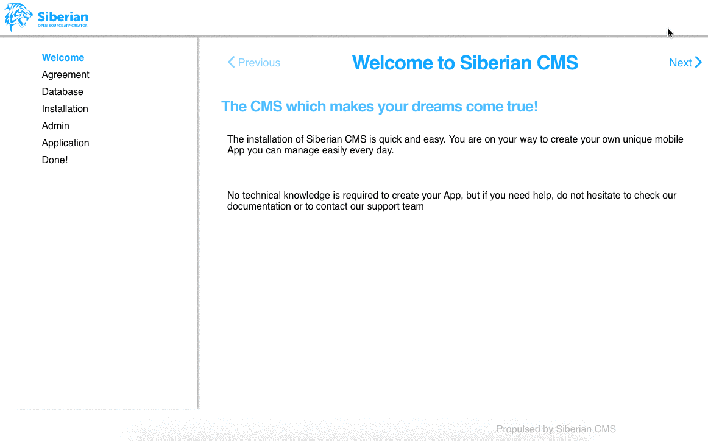

# Getting started

## What is Siberian

Siberian is a self-hosted platform to build, manage and publish mobile applications. You install it on your own server, then create apps from a backoffice and an editor, and publish them as native **iOS** and **Android** apps and as a web app.

An app is made of **features** (pages, forms, loyalty cards, push, catalogs...) arranged by a **layout** and dressed with a **template**. Everything on this site explains how to build, change or extend those pieces.

Three editions share the same core, a module declares the minimum it needs:

| Edition | Name | Use |
|---------|------|-----|
| SAE | Single App Edition | One app, for your own use |
| MAE | Multi App Edition | Several apps, for agencies and freelancers |
| PE | Platform Edition | A platform where your own customers create their apps |

## How it is built

* **Server:** PHP (Zend Framework 1) with a MySQL/MariaDB database. Controllers, models, forms and the backoffice and editor screens live here.
* **App:** an Ionic 1 / AngularJS web app running inside a Cordova shell (cordova-android 15, cordova-ios), so one code base produces the iOS app, the Android app and the web app. Apps support Android 8 and later, and iOS 15 and later.
* **Modules:** a feature is a module with a PHP part for the server and an Ionic part for the app, packaged and installed as a zip.

The exact versions of every framework and plugin are listed in [Frameworks](stack/frameworks.md).

## What a developer can do

| I want to... | Start here |
|--------------|------------|
| Add a new feature to the apps | [Modules](module.md) and [Basic usage](module/basic.md) |
| Add pages or fields to the editor | [Forms](module/forms.md), [Hooks](module/hooks.md) and [Menus](module/hooks/menus.md) |
| Add fields to the customer account | [My account](module/account.md) |
| Make a feature work without a connection | [Offline mode](module/offline-mode.md) |
| Send push notifications | [Push notifications](module/push.md) |
| Change how the home page looks | [Layouts](layout.md) |
| Change the whole look of the apps | [Templates](customization/template.md) and [Icons](customization/icon.md) |
| React to what happens (login, register, menus, app start) | [Hooks](module/hooks.md) |
| Call Siberian from another system | [API](api.md) |
| Script an installation | [Siberian CLI](cli/siberian.md) |
| Use the app services (dialogs, pictures, location...) | [Ionic tools](stack/ionic-tools.md) and [Utilities](stack/utilities.md) |
| Override or extend the core without editing it | [Core inheritance](module/core-inheritance.md) |
| Report a problem | [Contribute](contribute.md) |

## Where to start

1. **Install Siberian** on a server that meets the [requirements](#requirements), following [Installation](#installation).
2. **Read how a module is structured**: [Modules](module.md), then [Basic usage](module/basic.md).
3. **Build a small feature** and test it in the editor and in the app preview.
4. **Come back to the other pages** (hooks, forms, API) when you need them.

If you only want to use Siberian rather than extend it, you do not need this site: the backoffice and the editor are self-explanatory.

# Requirements

Siberian runs on a classic Linux web server. Check these four things before you install: the system, PHP, the database and a few command line tools.

## Server

| Component | Requirement | Notes |
|-----------|-------------|-------|
| Operating system | **Linux** | Production servers only |
| Web server | **Apache** or **Nginx** | Configuration examples in [Installation](#apache) |
| OpenSSL | **1.0.1** or later | With TLS 1.2 support |
| cURL | **HTTP/2** support | Check with `curl --version` |
| Database | **MySQL** or **MariaDB 5.5+** | InnoDB or XtraDB engine |

## PHP

| Setting | Requirement | Notes |
|---------|-------------|-------|
| Version | **8.2** minimum, **8.5** recommended | Supported range: `>=8.2 <8.6` |
| Extensions | `SimpleXML`, `pdo_mysql`, `gd`, `mbstring`, `iconv`, `curl`, `openssl` | The installer checks them |
| Functions | `exec()` | Must not be in `disable_functions` |
| `allow_url_fopen` | `On` | |
| `memory_limit` | `256M` or more | |
| `post_max_size`, `upload_max_filesize` | **64M** to **128M** recommended | At least 32M, large updates need more |

## Command line tools

| Tool | Status | Used for |
|------|--------|----------|
| `zip`, `unzip` | **Required** | Handling zip archives (packages, updates) |
| `pngquant` or `optipng` | Optional | Smaller PNG images |
| `jpegoptim` | Optional | Smaller JPEG images |

## Quick check

Run these on the server to see where you stand:

```bash
php -v
php -m | grep -i -E "simplexml|pdo_mysql|gd|mbstring|iconv|curl|openssl"
php -i | grep -E "allow_url_fopen|memory_limit|post_max_size|upload_max_filesize"
openssl version
curl --version | grep -i http2
zip -v | head -n 2
unzip -v | head -n 2
```

Everything in place? Continue with the [installation](#installation).

# Installation

## Configuration

1. First you will need to either checkout the project `git clone https://github.com/Xtraball/Siberian.git`

    or download the [zip archive](https://github.com/Xtraball/Siberian/archive/trunk.zip) then extract it on your webserver.

2. Setup your empty database and user

3. Configure your environment with [apache](#apache) or [nginx](#nginx)

### Apache

If you are running under Apache, be sure that the directive `AllowOverride all` is working, unless the `.htaccess` configuration will fail.

```
<VirtualHost [IP]:80>
        ServerName [yourdomain.tld]

		CustomLog [/path/to/siberiancms]/var/log/httpd.access_log combined
		ErrorLog [/path/to/siberiancms]/var/log/httpd.error_log

		DirectoryIndex index.php

        DocumentRoot [/path/to/siberiancms]

        <Directory [/path/to/siberiancms]>
                Options Indexes FollowSymLinks
                AllowOverride all
        </Directory>

</VirtualHost>
```


### Nginx

If you are running under Nginx, all you need is in the current configuration, 
please check the `fastcgi` options as they may vary depending on your installation

```
server {
    listen 80;

	root [/path/to/siberiancms];
		
	access_log [/path/to/siberiancms]/var/log/nginx.access_log;
	error_log [/path/to/siberiancms]/var/log/nginx.error_log;

	index index.php index.html index.htm;

	server_name [yourdomain.tld];
	
	location ~ ^/app/configs {
        deny all;
    }
    
    # Let's Encrypt configuration
    location = /.well-known/check {
        default_type "text/plain";
        try_files $uri =404;
    }

    location ^~ /.well-known/acme-challenge/ {
        default_type "text/plain";
        try_files $uri =404;
    }

	location / {
		try_files $uri /index.php?$query_string;
	}

	location ~ \.php$ {
		fastcgi_index index.php;
		fastcgi_pass 127.0.0.1:9000;
		fastcgi_param SCRIPT_FILENAME $document_root$fastcgi_script_name;
		include fastcgi_params;
		fastcgi_buffers 256 128k;
		fastcgi_connect_timeout 300s;
		fastcgi_send_timeout 300s;
		fastcgi_read_timeout 300s;
	}

    location ~* ^.+.(js|css|png|jpg|jpeg|gif|ico|html)$ {
		access_log        off;
		log_not_found     off;
		expires           0;
	}
	
	location ~ /\. {
		access_log off;
		log_not_found off;
		deny all;
	}

	gzip on;
	gzip_min_length  1000;
	gzip_proxied any;
	gzip_types text/plain application/xml text/css text/js application/x-javascript;
	
	client_max_body_size 128M;

}
```

When you're done with the previous steps, reload your web server.

Ensure `post_max_size` & `upload_max_filesize` are higher than 32M (64-128M recommended) at least, in case of large updates


## Web installer

* Go to `http://yourdomain.tld` then follow the instructions

