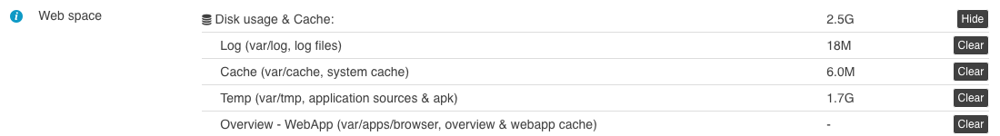

# Core inheritance & customization

[Edit this on Github](https://github.com/Xtraball/SiberianCMS-Doc/edit/master/docs/module/core-inheritance.md)

In SiberianCMS we have designed an inheritance system to allow for custom modification & improvements.

## How it works ?

Siberian ships as three editions, SAE, MAE & PE, and each one is a stack of folders in `app`:

```raw
local  >  pe  >  mae  >  sae           app/<layer>/<same relative path>
```

| Edition | Layers loaded (lowest to highest) |
|---------|-----------------------------------|
| SAE | `sae`, `local` |
| MAE | `sae`, `mae`, `local` |
| PE  | `sae`, `mae`, `pe`, `local` |

A file with the same relative path in two layers is **replaced** by the upper one, it is not merged: any file named the same as in a lower layer takes precedence on it. `local` always wins, this is where your modules live.

Be aware that the file you override may itself already be an override: on MAE and PE the file in `app/sae` can be hidden by a file of `app/mae` or `app/pe`, and then a copy of the `sae` one in `local` replaces the edition's version as well. Start from the file of the highest layer your edition has, not from the one in `app/sae`.

## Cache

The core inheritance is cached: every design file of a layer is listed in `app/<layer>/design/design-cache.json` (`app/local/design/design-cache.json` for your modules), and the layout only sends the files that are listed. So each time you add or remove a design file in local, the cache must be rebuilt, see [Module > Cache](../module.md#cache) (`./cli cache:design sae`, replace `sae` with your edition).

**Note: when installing and/or updating a module with the regular zip package, the cache is automatically cleared for the users.**

---

However you can also wipe various cache levels manually in the Backoffice dashboard:



## Example

### Design files

**If your module needs to override an actual Siberian design you must explicitely declare it in your module `init.php` (or the deprecated `bootstrap.php`)**

```php
<?php
$init = function ($bootstrap) {
    Siberian_Cache_Design::overrideCoreDesign("ModuleName");
};
```

The recommended way to override a template is to create a minimal module package, this way everything is self-contained and you can easily maintain code.

```raw
ModuleName
├─ resources
│  └─ design/desktop/siberian/template/loyaltycard/application/edit.phtml
└─ package.json
```

if you need to customize a template for example:

```raw
/app/sae/design/desktop/siberian/template/loyaltycard/application/edit.phtml
```

simply duplicate the file in your module:

```raw
ModuleName/resources/design/desktop/siberian/template/loyaltycard/application/edit.phtml
```

Then apply your modification into this module file/files.

&nbsp;

### Siberian core classes

**Overriding core classes is different, as they explicitely need the module to require classes**
*the autoloader will not find them as they will not be PSR compliant.*

Everything is declared in the `init.php` file (or the deprecated `bootstrap.php`) this way:

```php
<?php
$init = function ($bootstrap) {
    /** Get the base path to your module */
    $base = path("/app/local/modules/ModuleName/");

    /** Require the classes */
    require_once "{$base}/controllers/IndexController.php";
};
```

#### Example

You want to override:

```raw
/app/sae/modules/Admin/Model/Key.php
```

You have to create:

```raw
ModuleName
├─ [...]
├─ Admin/Model/Key.php
└─ [...]
```

Then require it in your `init.php`

```php
<?php
$init = function ($bootstrap) {
    /** Get the base path to your module */
    $base = path("/app/local/modules/ModuleName/");

    /** Require the classes */
    require_once "{$base}/Admin/Model/Key.php";
};
```


---

*Note: SiberianCMS regular update will not alter the local folder, so you can track your customizations safely.*