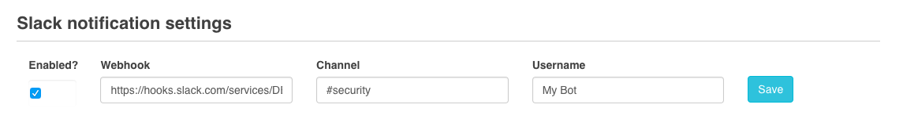

# Security

## Slack notifications

If you want to receive the WAF alerts in Slack.

Open the Firewall page of the Backoffice, the *Slack notification settings* section is always available (no `config.php` flag is needed).

Simply fill it with your Webhook URL, Channel & Username, tick *Enabled?* then save!

Every *Firewall* alert will trigger a notification in your subsequent Slack channel!
