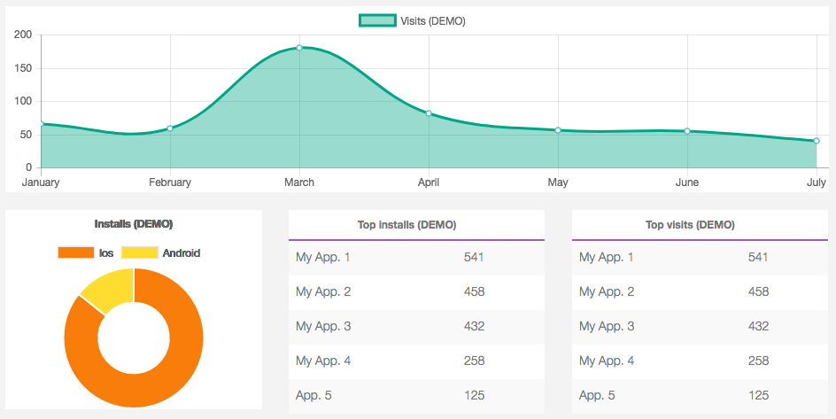
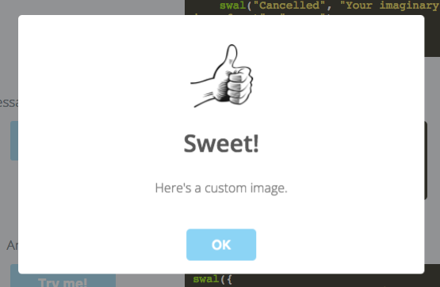

# Frameworks

[Edit this on Github](https://github.com/Xtraball/SiberianCMS-Doc/edit/master/docs/stack/frameworks.md)

Below you'll find a complete list of the various frameworks we use both in Editor, Backoffice & Applications.

Most of our Cordova & Ionic libraries are customized for Siberian.

## Editor

The main codebase inside the editor is powered with `jQuery` and `bootstrap`.

### FontAwesome 

- Version: `4.7.0`

- [See on Github](https://github.com/FortAwesome/Font-Awesome)

### Bootstrap 

- Version: `3.2.0`

- [See on Github](https://github.com/twbs/bootstrap)

### CKEditor

- Version: `4.13.1`

- CKEditor our richtext editor, used all across the Editor for every feature.

- [See on Github](https://github.com/ckeditor)

### CodeMirror

- Version: `latest`

- CodeMirror is used to highlight Code, Scripts & more, we use it for our inline `SCSS` editor & also as a plugin for our CKEditor source feature. 

- [See on Github](https://github.com/codemirror/CodeMirror)

### Chart.js

- Chart.js is powering our App analytics like below.

- [See on Github](https://github.com/chartjs/Chart.js) 



### DataTables

- [See on Github](https://github.com/DataTables/DataTables)

### nestedSortable

- [See on Github](https://github.com/ilikenwf/nestedSortable)

### prettyPhoto

- [See on Github](https://github.com/scaron/prettyphoto)

### jQuery UI

- [See on Github](https://github.com/jquery/jquery-ui)

### SweetAlert

- Version: `latest`

- [See on Github](https://github.com/t4t5/sweetalert)



*Basic example*

```js
swal("Here's a message!");
```

You can see [this page](http://t4t5.github.io/sweetalert/) for more advanced usage.


## Backoffice

In the backoffice we are mainly using AngularJS along with some plugins for UI, CKEditor, Graphs.

### FontAwesome 

- Version: `4.2.0`

- [See on Github](https://github.com/FortAwesome/Font-Awesome)


### Bootstrap 

- Version: `3.2.0`

- [See on Github](https://github.com/twbs/bootstrap)


### AngularJS

- Version: `1.3.0`

- [See on Github](https://github.com/angular/angular)


### CKEditor

- Version: `4.4.6`

- [See on Github](https://github.com/ckeditor)


## Backend

All our backend is running under Zend Framework with a complete custom stack on top of it, we also use libraries for Push & SCSS.

### PHP

- Version: from `8.2` up to `8.5` (`>=8.2 <8.6`), `8.5` recommended

- [See on Github](https://github.com/php)

### Zend Framework

- Based on ZF1, customized for Siberian (Zend Framework `1.12.3`) & topped with Siberian library

- [See on Github](https://github.com/zendframework/zf1)


## Applications

### Based on Ionic / AngularJS

- Ionic `1.3.5` (Ionic 1, not Ionic 2+), AngularJS `1.5.3`

#### Highly customized with

- Lazy & Modular loading
- Dynamic caching
- Extended SCSS

&nbsp;

### Cordova

#### All our cordova platforms are forked and customized.

#### Android

- Minimum Android 8.0 (API 26), `cordova-android` 15.1.0

- [See on Github](https://github.com/Xtraball/cordova-android)

#### iOS

- Minimum iOS 15, `cordova-ios` 6.1.1 (CordovaLib), the iOS shells are built with Xcode 26 in CI

- [See on Github](https://github.com/Xtraball/cordova-ios)

#### Browser

- [See on Github](https://github.com/Xtraball/cordova-browser)

&nbsp;

### Cordova Plugins

#### All our cordova plugins are forked and customized.

The list below follows `submodules.json`, each plugin lives in its own repository under `https://github.com/Xtraball/<Name>`, on the `siberian` branch.

|Plugin|Usage|
|------|-----|
|[AdmobPro](https://github.com/Xtraball/AdmobPro)|Google AdMob ads Banner & Interstitial|
|[AppVersion](https://github.com/Xtraball/AppVersion)||
|[Badge](https://github.com/Xtraball/Badge)||
|[BarcodeScanner](https://github.com/Xtraball/BarcodeScanner)|QRCode scanner|
|[BrowserTab](https://github.com/Xtraball/BrowserTab)||
|[Camera](https://github.com/Xtraball/Camera)|Camera & Library manager|
|[Clipboard](https://github.com/Xtraball/Clipboard)||
|[Device](https://github.com/Xtraball/Device)||
|[File](https://github.com/Xtraball/File)||
|[Geofence](https://github.com/Xtraball/Geofence)||
|[Geolocation](https://github.com/Xtraball/Geolocation)||
|[InAppBrowser](https://github.com/Xtraball/InAppBrowser)||
|[Insomnia](https://github.com/Xtraball/Insomnia)|Prevents sleep for continuous app usage like GPS navigation|
|[IonicWebview](https://github.com/Xtraball/IonicWebview)|Web view of the Android shell|
|[Keyboard](https://github.com/Xtraball/Keyboard)||
|[LocalNotifications](https://github.com/Xtraball/LocalNotifications)||
|[MediaNative](https://github.com/Xtraball/MediaNative)||
|[MusicControls](https://github.com/Xtraball/MusicControls)|Display music controls in Notification center|
|[Navigator](https://github.com/Xtraball/Navigator)||
|[Onesignal](https://github.com/Xtraball/Onesignal)|Push notifications|
|[Permissions](https://github.com/Xtraball/Permissions)|Android runtime permissions (a dummy JavaScript file on iOS)|
|[Promises](https://github.com/Xtraball/Promises)||
|[PluginSiberian](https://github.com/Xtraball/PluginSiberian)||
|[SocialSharing](https://github.com/Xtraball/SocialSharing)||
|[SplashScreen](https://github.com/Xtraball/SplashScreen)||
|[StatusBar](https://github.com/Xtraball/StatusBar)||
|[WebView](https://github.com/Xtraball/WebView)||
|[Whitelist](https://github.com/Xtraball/Whitelist)||

The iOS shell uses `IosXhr` instead of `IonicWebview`, see [docs/mobile-parity.md](https://github.com/Xtraball/Siberian/blob/trunk/docs/mobile-parity.md) in the Siberian repository for the differences between the Android and iOS plugin versions.

&nbsp;

### Javascript

#### Swiper

- Version: `3.4.2`

- [See on Github](https://github.com/nolimits4web/Swiper)

&nbsp;

#### Lodash

- Version: `4.13.1`

- [See on Github](https://github.com/lodash/lodash)

&nbsp;

#### LocalForage

- Version: `1.4.3`

- [See on Github](https://github.com/localForage/localForage)

&nbsp;

#### Siberian NqQueue

- [See on Github](https://github.com/Xtraball/angular-queue)

&nbsp;

#### Moment.js

- Version: `2.18.1`

- [See on Github](https://github.com/moment/moment)

&nbsp;

#### ProgressBar

- Version: `1.0.1`

- [See on Github](https://github.com/kimmobrunfeldt/progressbar.js)

&nbsp;

