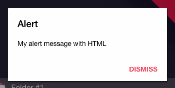
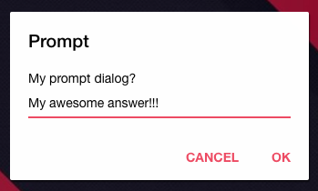
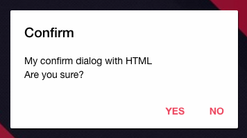
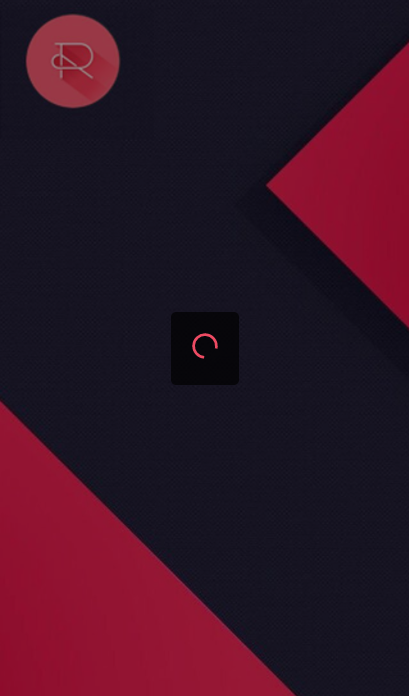
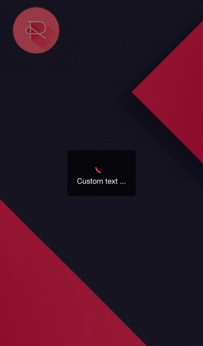
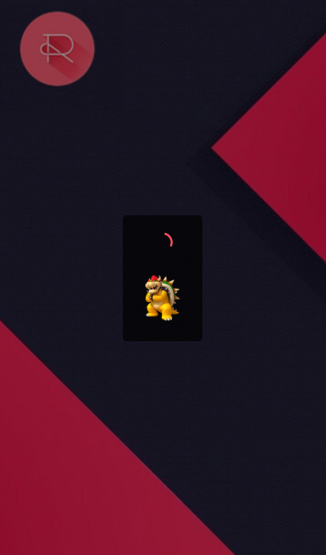

# Ionic Tools

We've build our own services on top of Ionic to be more resilient when updating frameworks.

# Dialog

The `Dialog` service is used to handle `Alert`, `Prompt` & `Confirm` popups taking care of the stack, and extended with nice features.
This service also takes care of the translations, every `String` goes into `$translate.instant(text)`

And if `context` is defined, strings goes into `$translate.instant(text, context)`.

Dialog methods always return a promise

## Alert

```js
Dialog.alert(title, message, button, dismiss, context);
```



#### options

|Key|Type|Default|Usage|
|---|---|---|---|
|title|String|---|Dialog title|
|message|String|---|Dialog message `text`|
|button|String|---|Dialog button text, dismiss or ok|
|dismiss|Integer|undefined|When defined, the Dialog will automatically dismiss after the given time in ms, if set to `-1` the dismiss time will be calculated automatically|
|context|String|undefined|When defined, the context will be used to translate strings|

## Prompt

```js
Dialog.prompt(title, message, type, value, buttons_array, css_class, context);

Dialog.prompt(title, message, type, value, buttons_array, css_class, context)
    .then(function (result) {
        // the text typed by the user
    });
```



#### options

|Key|Type|Default|Usage|
|---|---|---|---|
|title|String|---|Prompt title|
|message|String|---|Prompt message `text`|
|type|String|text|`text` or `password`, defaults to `text` if undefined|
|value|String|undefined|Placeholder if type is set to `text`|
|buttons_array|Array|`["OK", "CANCEL"]`|The two buttons: validate, then cancel|
|css_class|String|undefined|CSS class used to customize render|
|context|String|undefined|When defined, the context will be used to translate strings. It is the seventh argument: pass `undefined` for the ones you skip|


## Confirm

```js
Dialog.confirm(title, message, buttons_array, css_class, context);

Dialog.confirm(title, message, buttons_array, css_class, context)
    .then(function (result) {
        if (result) {
            // Confirmed
        } else {
            // Cancelled
        }
    });
```



#### options

|Key|Type|Default|Usage|
|---|---|---|---|
|title|String|---|Confirm title|
|message|String|---|Confirm message `text`|
|buttons_array|Array|---|`["YES","NO"]`|
|css_class|String|undefined|CSS class used to customize render|
|context|String|undefined|When defined, the context will be used to translate strings|

&nbsp;

&nbsp;

----

# Modal

This Modal service is using $ionicModal but will take cares of the stacking, the parameters & config are the same as the $ionicModal ones.

The service also takes care of removing the Modal when closing via `modal.hidden` subscribers.

The Modal service returns a promise with the modal object

## fromTemplateUrl

```js
Modal.fromTemplateUrl(templateUrl, config);

Modal.fromTemplateUrl(templateUrl, config)
    .then(function (modal) {
        // Do Whatever you want with your modal!
    });
```

## fromTemplate

```js
Modal.fromTemplate(template, config);
```

&nbsp;

&nbsp;

----

# Loader

With this loader wrapper, you can only open the Loader once.
Also the loader comes with a backdrop modal preventing any action!

## Show

```js
Loader.show(text, config);
```

#### default

```js
Loader.show()
```



#### example with text

```js
Loader.show("Custom text...")
```



#### example with image

```js
Loader.show("<br />")
```



## Hide

```js
Loader.hide();
```


&nbsp;

&nbsp;

----

# Location

The location services is used to get the current position, with refresh rules to avoid GPS spam & abuse.

## getLocation

#### usage 

```js
Location.getLocation(config, force)
    .then(function(position) {
        /** position: {
                coords: {
                    latitude  
                    longitude 
                    altitude
                    accuracy
                    altitudeAccuracy
                    heading
                    speed
                }
                timestamp                
            }
        */
    }, function(error) {
        // action on error
    })
```

Returns a promise

If `force` is defined, whatever its value (`true` as well as `false`), the GPS request will be immediate. Leave it
`undefined` to let the service decide: if the latest fetch is less than 42 seconds old, it returns the latest saved
position within the promise then refreshes it in background.

If the position cannot be found (permission denied, timeout, position unavailable), the promise is rejected and the
service stops asking for the next calls, to avoid asking again and again.

&nbsp;

#### default config

```js
{
    enableHighAccuracy: true,
    timeout: 10000,
    maximumAge: 0
}
```

## getLatest

```js
Location.getLatest()
    .then(function(position) {
        /** position: {
                coords: {
                    latitude  
                    longitude 
                    altitude
                    accuracy
                    altitudeAccuracy
                    heading
                    speed
                }
                timestamp                
            }
        */
    }, function(error) {
        // action on error
    })
```

Returns a promise

Get latest will return the latest position, without taking care of the freshness, 
if the position was never fetched, it will try to fetch it however.


&nbsp;

&nbsp;

----

# Picture

The picture service asks the user whether to take a new picture with the camera or to import one from the library
(in the browser preview, it opens a file picker instead). It needs no permission from your module: the system picker
is used to import a picture, and the camera permission is asked by the camera plugin when it is needed.

## takePicture

```js
Picture.takePicture(width, height, quality)
    .then(function (response) {
        /**
            The image is returned as a data URI.
            response: {
                image: "data:image/jpeg;base64,/9j/4AAQ..."
            }
        */
    }, function (error) {
        if (error && error.cancelled) {
            // The user backed out of the menu, of the camera or of the library.
            // Nothing went wrong and nothing was shown: do nothing.
            return;
        }

        // Any other error was already reported to the user with a dialog,
        // you only need to reset your own state here.
    });
```

All three arguments are optional.

#### options

|Key|Type|Default|Usage|
|---|---|---|---|
|width|Integer|1200|Max width in pixels, from 1 to 10000. The picture keeps its proportions.|
|height|Integer|1200|Max height in pixels, from 1 to 10000.|
|quality|Integer|90|JPEG quality, from 0 to 100.|

A value that is missing, or not a number, falls back to its default. A value out of range is brought back to the
nearest limit.

#### Good to know

- `response.image` is always a complete data URI, whatever the version of the camera plugin in the app: the plugin
  returned the bare base64 up to version 7 and a data URI from version 8, and `Picture` accepts both. Use it as is,
  for example ``, and do not add `data:image/jpeg;base64,` yourself.
- Handle the rejection even if you do nothing with it: a promise rejected by the user backing out is otherwise
  logged as "Possibly unhandled rejection".
- Calling `takePicture` while the menu is already open rejects at once, without an error object.
- The whole picture is kept in memory as text, so ask for a size that matches what you really need (the default
  1200 px is enough for an avatar or a post), and send it to the server in one request.


&nbsp;

&nbsp;

----

# SocialSharing

## share

```js
SocialSharing.share(content, message, subject, link, file)
```

When using `SocialSharing.share()` with no parameters, the default message will be `Hi. I just found this in the MyAwesomeApp app.`

&nbsp;

If only `content` is defined, `this` will be replace by `content`, like `Hi. I just found a new awesome music in the MyAwesomeApp app.`

&nbsp;

When defining `message` it will completely override the default message including `content`, like `Just wanted to share this song with you guy's`
but you can use `$1` as a placeholder for `content`, and `$2` as a placeholder for the Application name, like `Just wanted to share $1 with you guy's, in the App $2`

&nbsp;

`link` will default to the Application download link

&nbsp;

#### options

|Key|Type|Default|Usage|
|---|---|---|---|
|content|String|undefined|Default placeholder text|
|message|String|undefined|Message replacing the default one|
|subject|String|undefined|Subject or your shared message|
|link|String|undefined|Default to the Application download link|
|file|String|undefined|A file url, an album cover or pdf for example|

&nbsp;

&nbsp;

----

# Customer

The customer service, is the only entry point you should use when dealing with user accounts, this in order to avoid any unwanted and/or duplicated behaviors.


## loginModal


```js
Customer.loginModal(scope, login_callback, logout_callback, register_callback)
```

&nbsp;

#### options

|Key|Type|Default|Usage|
|---|---|---|---|
|scope|Object|undefined|If undefined, the scope will be $rootScope|
|login_callback|Function|undefined|A function to be called on a sucessfull login|
|logout_callback|Function|undefined|A function to be called on a sucessfull logout|
|register_callback|Function|undefined|A function to be called on a sucessful registration|

&nbsp;

&nbsp;

----

# $session

The session provider contains the session id, the uid, and the screen resolution.

This service is also used to store session data in localStorage.

## getId

```js
$session.getId()
```

## getDeviceUid

```js
$session.getDeviceUid()
```

## getDeviceScreen

```js
$session.getDeviceScreen()

/**
{
    width,
    height,
    orientation
}
*/
```

## setItem

```js
$session.setItem(key, value)
```

## getItem

```js
$session.getItem(key)
    .then(function(value) {
        // the retrieved value, or null if it doesn't exists
    });
```

## removeItem

```js
$session.removeItem(key)
```
